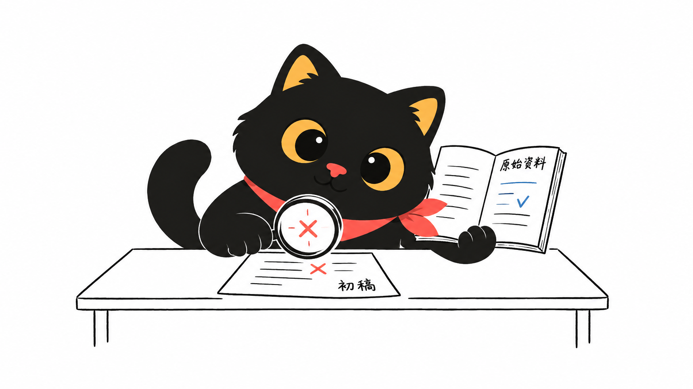

# AI 能帮你做得更快，但你得知道什么算做好

打开 AI，输入“帮我写一份方案”，很快就能得到一篇结构完整、语气自信的文字。接着怎么办？直接交出去，还是再改几轮？如果连自己都说不清什么叫好，改到第五轮也可能只是在更换措辞。

这正是阅读《A Motorcycle for the Mind》时值得追问的问题。这篇发表于 2026 年 2 月 19 日的网页，是 Naval 与 Nivi 的播客对谈文字稿，讨论 AI、工作与学习。临近结尾，Naval 把 AI 比作“a motorcycle for the mind”，也就是一辆给头脑使用的摩托车：动力更强了，仍需要有人驾驶、决定方向和刹车。

这个比喻适合用来理解个人与 AI 的关系，但它不是对就业安全的保证。下文借用对谈中的几个观点，讨论普通人可以怎样工作和学习；具体做法与判断，是本文的延伸分析。

## 工作的难处，会从动手移到判断

Naval 在谈到用自然语言生成程序时，强调了一种变化：一个人可以先描述想要什么，再看结果、提意见、反复修改，不必亲手写出每一行代码。他也明确说，传统软件工程没有因此消失。懂得底层原理的人，仍更容易发现错误、处理复杂问题。

把这个观察移到日常办公，可以得到一个更有限、也更实用的判断：部分制作工作变容易后，说明需求和验收结果的重要性会上升。

假设你要准备一份活动方案。“帮我做个方案”没有交代预算、人数、场地限制，也没说明到底要拉新、成交，还是维护老客户。AI 可以把空缺补成一篇很像方案的文章，可那些补充未必符合实际。

不妨先写清楚：活动给谁办，最想解决什么问题，有哪些不能突破的条件。再让 AI 提出几个可比较的选择，并列出各自还缺什么信息。这样，你面对的就不只是漂亮文案，而是一组需要取舍的安排。

这里有个容易忽略的成本。初稿生成得越快，备选方案越多，审阅的负担也可能越大。十份方案不一定比两份更有帮助。对普通使用者来说，值得练习的是先定验收条件：哪些数字必须核实，哪些承诺不能写，哪一步做不到就要放弃。没有这些条件，所谓提效可能只是把写作时间换成了挑选时间。

## 会提问，还要会找证据

对谈中，Naval 说自己会把问题交给多个 AI，再比较答案，必要时追问数据和依据。这是他的使用习惯，并不是经过该对谈证明的可靠性标准。

本文更愿意把多模型比较当作发现分歧的办法，而不是事实核验的终点。几个模型可能引用同一份材料，也可能重复相似的错误。答案一致，只能说明它们一致，不能单凭这一点认定事情为真。

比如，你请 AI 整理某项补贴政策。它可以帮你拆解申请条件、列出待准备材料；但资格、截止时间和办理入口，仍应回到主管部门的原始文件核对。如果它给出一个链接，要打开看看，确认页面确实存在，内容也确实支持那个结论。

这还意味着，任务要按出错的代价区别对待。给内部讨论起几个标题，可以宽松一些；替客户写合同条款，或根据健康信息作决定，就不能只靠一段流畅回答。涉及专业判断时，还需要有资格的人复核。未经允许，也不要把客户资料和公司机密直接交给外部工具。

工作中可以给 AI 一个明确要求：把已有材料支持的事实、你的推测和仍待确认的问题分开列出。这不能保证它不出错，却能让你更容易找到需要检查的地方。最后签名、发送或执行的人，仍须知道自己交出了什么。

## 学习时，别把听懂当成会做

这场对谈里，与普通读者关系很近的另一部分是学习。Naval 看重 AI 能耐心地换说法、举例子、画图，并根据学习者已有的知识解释问题。Nivi 也谈到自己用模型学习数学概念的体验。这里需要保留边界：个人感觉解释准确，不等于模型在整个学科都可靠。

不过，随时追问确实提供了一种值得尝试的学习方式。读教材时卡在一句话上，你可以直接指出：“前半句懂了，后半句为什么能推出这个结论？”不必为了显得聪明，把问题包装成复杂术语。

真正要小心的是，解释太顺，容易让人误以为自己已经掌握。看别人做饭时觉得每一步都明白，轮到自己开火，才发现不知道该什么时候关火。学习概念也有类似的差别。

因此，本文建议把 AI 的两种角色分开使用。第一次让它讲解，第二次让它出题，但先不给答案。你自己完成后，再请它指出哪一步有问题，并回到教材或可信资料确认。

例如学习百分比，可以先弄清“增长百分之十”以哪个数为基准，然后合上解释，自己算一道先涨价、再降价的题。如果做错，追问具体错误，而不是再听一遍宽泛介绍。最后换一个情境，看能不能独立判断。

检验学习有没有发生，可以问得很朴素：关掉聊天窗口，我还能解释吗？换一题，还会做吗？我知道这个说法在什么条件下不适用吗？这些检查比收藏一长串问答更接近你真正想获得的能力。

## 不必追每个技巧，但要懂自己的任务

Naval 对追逐短命的提示词技巧颇不以为然。他认为工具会越来越适应人的表达。不过，他同时交代了自己的前提：能够有条理地表达，也了解计算机和程序员怎样工作。他还鼓励有兴趣的人看看工具背后的原理。

所以，把他的意思理解成“什么都不用学，随便聊就行”，会漏掉关键条件。不追每个新技巧，与不学习如何判断结果，是两回事。

对大多数人，更耐用的练习也许是描述一件具体的事：现在遇到了什么困难，手头有什么材料，期待什么结果，哪些地方不能妥协。这些能力即使不用 AI，也有助于和同事合作。你越熟悉自己的工作，越容易指出一个回答哪里不合用。

也不必因此走向另一个极端，先把机器学习课程全部学完才开始用。可以从小任务入手，哪里反复出错，就补哪里的知识。让工具整理表格总出问题，就先弄清字段含义、单位和空值；让它概括文章总漏掉条件，就练习对照原文检查限定语。学习由实际困难带动，比漫无目的追更新更有着落。

## 从一件能验收的小事开始

Naval 对 AI 的长期影响相当乐观，也谈到了某些工作被替代的可能。这些是他的判断和展望，不应写成已经兑现的结果。对收入和岗位的担忧，也不能简单归咎于一个人不愿学习。

普通人能先做的，是为自己积累一点具体证据。挑一件低风险、经常重复、又有办法判断对错的事：把公开资料整理成对照表，改一封不含敏感信息的邮件，或者练习一个总弄不懂的概念。

做之前写下合格标准。做完之后，把提问、等待、修改和核查的时间一起算进去，再判断它有没有帮上忙。如果每次修错都比自己做更费事，就缩小交给它的范围，或暂时不用。没有必要为了证明自己跟上时代，硬把所有事情塞进聊天框。

这辆“头脑的摩托车”值得试骑。但试骑的收获，不只是跑得更快，也包括知道哪段路适合它，哪里该慢下来，以及什么时候需要自己下车走一段。

---

来源：[Naval Podcast — A Motorcycle for the Mind](https://nav.al/ai)，网页标注发表于 2026 年 2 月 19 日，对谈者为 Naval 与 Nivi。本文为原创解读，非全文翻译；仅保留必要短引文，工作与学习中的具体例子、操作建议均为本文分析，不是对谈者或用户的亲身经历。配图使用用户确认原创的红领巾黑猫角色，由 AI 生成。
