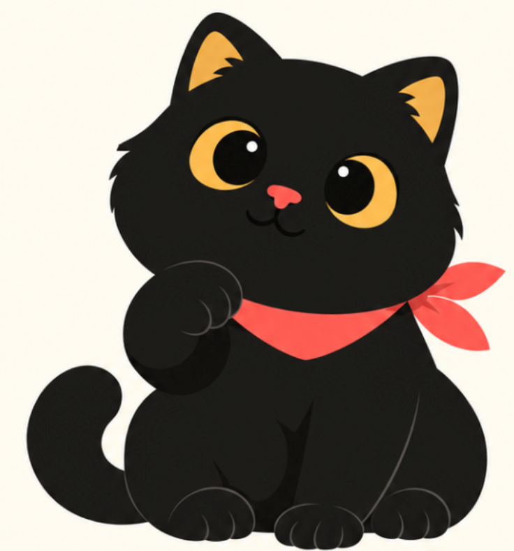

# Oppenheimor 红领巾黑猫插画

为中文文章设计配图策略，并生成以自有红领巾黑猫 IP 为主角的白底手绘正文插图。



## 使用

```text
使用 $oppenheimor-cat-illustrations，先为这篇文章给出 4 张配图建议，不要生成图片。

使用 $oppenheimor-cat-illustrations，为这段关于信息筛选的文字生成一张黑猫操作筛网的正文插图。

使用 $oppenheimor-cat-illustrations，把这张配图的旧主角换成我们的红领巾黑猫，保留文字和布局。
```

安装：

```bash
npx skills add https://github.com/oppenheimor/oppenheimor-agent-skills --skill oppenheimor-cat-illustrations
```

## 角色与风格

- 黑色圆润猫身、金黄大眼与耳内、珊瑚红鼻子、红领巾、圆爪和粗尾巴。
- 每次生图传入 `assets/character-reference.png`，不靠文字猜角色。
- 保留角色的可亲感，场景使用纯白底、大量留白、轻量手绘与少量中文批注。
- 猫参与核心动作，不能变成漏斗或机器，也不能只是角落装饰。
- 默认目标 16:9；工具原生比例不匹配时安全裁切空白或扩展白底，并验证实际尺寸。

Pi 中使用 `codex_image`，其他环境需要可传参考图的图像生成工具。没有工具时只交付策略与提示词，不假装已生图。

执行说明见 [SKILL.md](SKILL.md)。默认输出到用户工作区的 `assets/<article-slug>-illustrations/`。

## 改造说明

配图策略与手绘隐喻方法改编自 Ian 的 **Ian Xiaohei Illustrations**。本版本已替换角色设定、提示词、检查规则、技能名与入口，移除旧角色示例图及原作者推广二维码，以免误用为新 IP 参考。当前附图是用户提供的角色锚点，不是生成效果样例；尚未附带新角色的生成示例。

保留原 [MIT 许可证](LICENSE)，来源与资产说明见 [NOTICE.md](NOTICE.md)。
